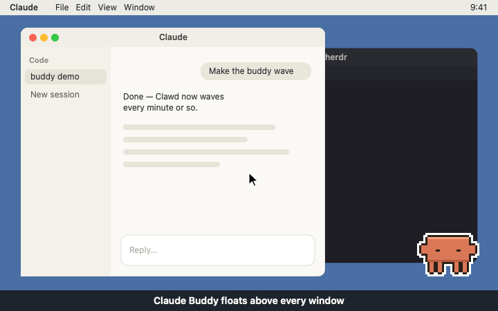

# Peep

A small pixel buddy that floats on your Mac desktop and tells you when Claude Code needs you.



- **Pings you** with a sound, a notification and a "!" badge when a session finishes.
- **Gets confused** (with a "?") when a session waits on a permission prompt or a question.
- **Takes you there**: double-click the buddy to jump to the session that pinged you. This works for herdr, zellij and tmux panes, iTerm tabs, and Claude desktop Code tab sessions.
- **Counts**: several waiting sessions show as a number. Each double-click opens the newest one.
- **Twelve skins** across whimsical, cute, cyber, fantasy, scientific and seasonal themes.

> Unofficial community project. Not affiliated with or endorsed by Anthropic.

## Installation

### For humans

Paste this into Claude Code (or any coding agent):

```
Install Peep by following the "For LLM agents" steps in
https://raw.githubusercontent.com/jclasley/peep/main/README.md
```

<details>
<summary>Or install it by hand</summary>

1. Download `Peep.zip` from the [latest release](../../releases/latest) and unzip it.
2. Move **Peep** to your Applications folder.
3. Open it. The app is not notarized, so macOS blocks the first launch. Right-click the app → **Open** → **Open**, or allow it in System Settings → Privacy & Security.
4. When the buddy asks, click **Install hooks**. Then allow notifications.

</details>

New Claude Code sessions pick up the hooks. Sessions that are already running need a restart. To have the buddy start every time you log in, right-click it → Settings → **Open at login**.

### For LLM agents

Follow these steps in order. Tell the user what you are about to do before steps 3 and 4, since they change files outside the current project.

1. **Check the system.** Run `sw_vers -productVersion`; macOS must be 13 or newer. Check that Claude Code is set up: `~/.claude` exists. If either check fails, stop and tell the user.
2. **Download the app.**
   ```sh
   curl -fL -o /tmp/Peep.zip https://github.com/jclasley/peep/releases/latest/download/Peep.zip
   rm -rf /tmp/Peep && ditto -x -k /tmp/Peep.zip /tmp/Peep
   ```
   If there is no release yet, build it instead (needs Xcode 15+): clone the repo, run `scripts/build.sh`, and use `build/Peep.app` in step 3.
3. **Install the app.** Quit any running copy, then replace the old app:
   ```sh
   pkill -x Peep || true
   rm -rf "/Applications/Peep.app"
   mv "/tmp/Peep/Peep.app" /Applications/
   ```
4. **Install the Claude Code hooks.** This edits `~/.claude/settings.json`. It keeps every other setting and hook, saves `settings.json.bak` first, and refuses to touch a file that isn't valid JSON.
   ```sh
   "/Applications/Peep.app/Contents/MacOS/Peep" --install-hooks
   ```
5. **Start it.**
   ```sh
   open "/Applications/Peep.app"
   ```
   If macOS says the app can't be opened because it isn't notarized, ask the user to right-click it in Applications → **Open** → **Open**. Do not change Gatekeeper settings yourself.
6. **Hand over to the user.** Tell them:
   - Allow notifications when macOS asks.
   - The buddy floats in the bottom-right corner. Right-click it → **Test alert** to try it.
   - Restart any Claude Code sessions that are already running, so they load the hooks.
   - Right-click → Settings → **Open at login** starts the buddy every time they log in.
   - If double-clicking opens the wrong terminal, set Settings → **Terminal** and **Multiplexer** by hand.

To uninstall: run the binary with `--uninstall-hooks`, quit the app, delete `/Applications/Peep.app`, and optionally delete `~/.peep`.

## Use

| Action | What happens |
|---|---|
| Drag | Move the buddy anywhere |
| Double-click | Open the newest waiting session, or Claude if nothing is waiting |
| Right-click | Waiting notifications, open sessions, skins, settings, test alerts |

**Settings** (right-click → Settings):
- **Terminal** and **Multiplexer**: Auto detects them per session. Pick one if Auto guesses wrong.
- **Alert sources**: Claude Code in a terminal, the Claude desktop Code tab, and desktop chat (beta; needs Accessibility permission and only brings the app to the front).
- **Claude Code hooks**, **Sound**, **Open at login**.

## Uninstall

1. Right-click the buddy → Settings → turn off **Claude Code hooks**.
2. Quit the buddy and delete the app.
3. Optionally delete `~/.peep`.

## Build from source

Requires macOS 13+ and Xcode 15+.

```sh
swift run Peep --check   # self-check
scripts/build.sh                # builds build/Peep.app and build/Peep.zip
open "build/Peep.app"
```

Pushing a `v*` tag builds the app on GitHub Actions and publishes the zip as a release.

See [CLAUDE.md](CLAUDE.md) for how the code is laid out and how to add skins, settings, hook events, terminals and multiplexers.
